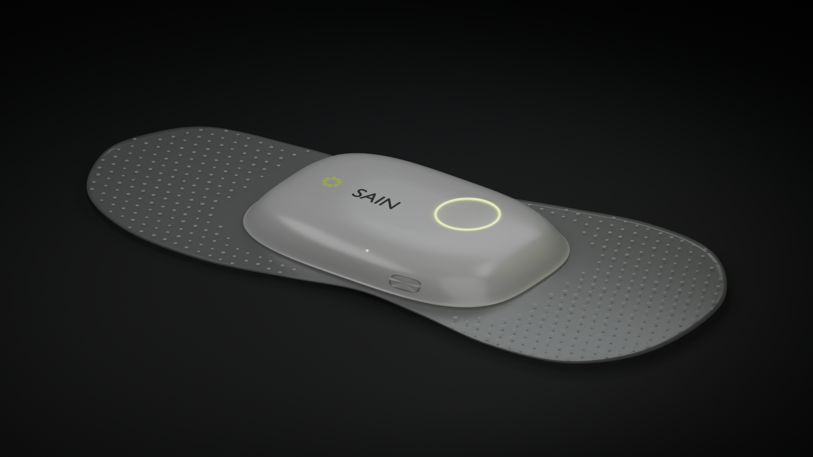
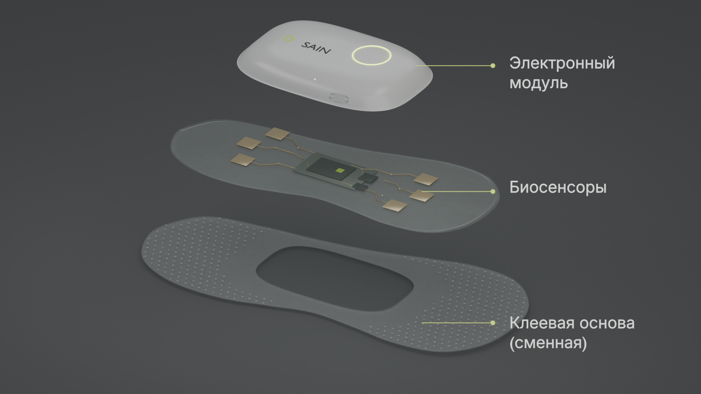

# Хакатон Sain x Школа 21

# Team 5
КОНЦЕПЦИЯ УСТРОЙСТВА:
1. Идея устройства
    Мы предлагаем создать компактное автономное носимое устройство для сбора
    физиологических и поведенческих данных пользователя.
    Концепция предполагает использование двух компонентов:
        1. Многоразовый электронный модуль со встроенными датчиками, аккумулятором и системой
        беспроводной передачи данных
        2. Сменная гибкая клеевая основа, которая обеспечивает крепление устройства и контакт
        датчиков с кожей
    Устройство располагается в верхней части грудной клетки и автоматически собирает данные в
    фоновом режиме.
    Основная задача собирать данные, чтобы платформа Sain могла анализировать образ жизни
    пользователя, формировать 11 показателей профиля и еженедельно предлагать гипотезы об
    изменении его привычек.

2. Конструкция и характеристики
    Наша концепция предусматривает следующие параметры:
        1. Форм-фактор: компактный носимый патч со съемным электронным модулем
        2. Расположение: верхняя часть грудной клетки(опционально)
        3. Размер электронного модуля: 35 × 23 мм
        4. Предполагаемая толщина модуля: 6–8 мм
        5. Размер сменного патча: 75 × 35 мм
        6. Предполагаемая масса всей конструкции: 10–13 г
        7. Вероятная автономность: до 7 дней
        8. Питание: встроенный перезаряжаемый аккумулятор
        9. Передача данных: беспроводная синхронизация со смартфоном
        10. Конструкция: многоразовая электроника и сменная гибкая основа
    Устройство не имеет экрана и не требует постоянного взаимодействия с пользователем.
    Указанные размеры, масса и автономность являются целевыми характеристиками концепта.
    Также были проработаны в рамках небольшого кастдева среди инженеров, и требуют проверки
    при создании физического прототипа

3. Датчики и источники данных
    В конструкции предполагается использование следующих технологий:
        1. ЭКГ-электроды: регистрация электрической активности сердца и получение данных для
        анализа физиологического состояния
        2. Трехосевой акселерометр: определение двигательной активности, периодов покоя и
        изменений положения тела
        3. Гироскоп: дополнительный анализ движений и ориентации устройства
        4. Wi-Fi-сканирование: получение контекстных данных о нахождении пользователя в знакомой
        среде
        5. Беспроводной модуль связи: синхронизация собранной информации со смартфоном

    Источники данных для 11 показателей:
        1. Хронотип: Определяется на основе предполагаемых периодов сна и бодрствования с
        использованием ЭКГ и акселерометра
        2. Отбой в будни: Оценивается по снижению двигательной активности и физиологическим
        сигналам
        3. Подъем в будни: Определяется по возобновлению двигательной активности и изменению
        физиологических сигналов
        4. Длительность сна: Рассчитывается по предполагаемому времени начала и окончания сна
        5. Социальный джетлаг: Оценивается на основе различий между режимом сна в рабочие и
        свободные дни
        6. Уровень активности: Определяется с использованием акселерометра и гироскопа
        7. Часы сидя: Оцениваются по данным о движении и положении тела
        8. Дни тренировок: Определяются по периодам повышенной двигательной активности и
        изменениям сердечного ритма
        9. Работа из дома: Предполагается определение по Wi-Fi-контексту и повторяющимся
        поведенческим закономерностям
        10. Телефон перед сном: Данные поступают непосредственно со смартфона при наличии
        разрешения пользователя. Если информация недоступна, система возвращает значение
        unknown
        11. Индекс движения Sain: Рассчитывается программным алгоритмом на основе данных
        двигательной активности
    Часть показателей определяется косвенными методами. Их точность зависит от качества
    сигналов, алгоритмов обработки и доступности дополнительных источников данных

4. Принцип работы
    После первоначального подключения устройство автоматически начинает сбор доступных
    сигналов.
    Процесс работы состоит из нескольких этапов:
        1. Датчики регистрируют физиологические и двигательные сигналы
        2. Данные временно сохраняются во внутренней памяти устройства
        3. При синхронизации информация передается на смартфон
        4. Серверная часть Sain анализирует информацию и формирует 11 показателей профиля
        пользователя
        5. На основе недельной динамики система выдвигает три гипотезы об изменениях образа
        жизни
        6. Пользователь подтверждает или отклоняет гипотезы в разработанном нами
        веб-интерфейсе Sain
    Для каждого показателя предусмотрена оценка уверенности от 0 до 1. Если информации
    недостаточно, система должна обозначать неопределенность

5. Питание и автономность
    Устройство предусматривает встроенный перезаряжаемый аккумулятор.
    Целевая продолжительность автономной работы до 7 дней
    Для снижения энергопотребления мы предполагаем:
        1. Энергоэффективные режимы микроконтроллера
        2. Периодический сбор данных там, где непрерывные измерения не требуются
        3. Локальное накопление информации
        4. Пакетная передача данных вместо постоянной беспроводной синхронизации
        Электронный модуль можно снять для зарядки, не заменяя всю конструкцию
    Фактическая автономность зависит от выбранных компонентов, емкости аккумулятора и
    частоты измерений. Точные временные показатели можно будет определить после тестов
    прототипа

6. Почему устройство не мешает пользователю
    Главная особенность это автономная работа без необходимости постоянного участия
    пользователя.
    Устройство:
        1. Не требует ручного запуска каждого измерения
        2. Не имеет экрана и сложных элементов управления
        3. Не отправляет постоянные уведомления
        4. Не требует ежедневного ввода данных
        5. Автоматически собирает информацию в фоновом режиме
        6. Использует компактную конструкцию, рассчитанную на повседневное ношение
    Пользователь взаимодействует преимущественно с результатами анализа в интерфейсе Sain, а
    не с самим устройством
    При этом устройство, как и любой другой гаджет подобного типа, требует периодической
    зарядки, а также замены клеевой основы

7. Техническая реализуемость и ограничения
    Концепция нашего устройства основана на существующих технологиях электроники.
    Для практической реализации необходимо дополнительно проверить:
        1. Возможность размещения датчиков, аккумулятора и электроники в корпусе 35 × 23 × 6–8
        мм( возможно придется расширить электронный модуль до 45 х 35 х 6-8 мм)
        2. Возможность автономной работы до 7 дней( проанализировав задействуемые датчики, мы
        пришли к выводу, что если внедрить нашу идею с энергоэффективным режимом
        микроконтроллера, то длительность непрерывной работы устройства может составлять до
        7 дней)
        3. Качество ЭКГ-сигнала при повседневном ношении
        4. Точность определения сна, активности и положения тела
        5. Энергопотребление Wi-Fi-сканирования
        6. Надежность крепления и комфорт длительного контакта с кожей

8. Эскиз устройства в формате рендера
    ### Внешний вид устройства

    

    ### Конструкция устройства

    Устройство состоит из трех основных элементов:

    1. **Электронный модуль** — многоразовый корпус с электроникой и световой индикацией
    2. **Биосенсоры** — слой с датчиками и электронной схемой
    3. **Клеевая основа** — сменная гибкая основа для крепления устройства к коже

    

## 1. Запуск

**Серверная часть**

Backend написан на Python 3.11 с использованием FastAPI.

Для развёртывания на стенде используется GitHub Actions. После обновления ветки `main` workflow `deploy.yml` автоматически устанавливает зависимости из `requirements.txt` и запускает сервер через `start.sh`.

Команда для повторного запуска развёртывания:

```bash
gh workflow run deploy.yml --ref main
```

Для этого требуется настроенный GitHub CLI и доступ к репозиторию. При обычной работе деплой запускается автоматически после слияния изменений в `main`.

Адрес сервера: https://team05.hack.be-healthy.tech

Локальный запуск после установки зависимостей:

```bash
sh start.sh
```

**Клиентская часть**

Frontend разработан на React, TypeScript и Vite. Для запуска из корня репозитория:
Он находится в процессе разработки (реализован базовый визуал экранов)

```bash
cd frontend && npm ci && npm run dev
```

**Концепт автономной вещи**

[Добавить название и эскиз или рендер устройства. Кратко описать, какие данные оно собирает, на каких технологиях работает, как питается и почему не требует внимания пользователя.]

## 2. Роли


Иван (kangsqua): Frontend, настройка репозитория на GitHub, CI/CD, тестирование и деплой
Савва (squeakyt): Разработка алгоритмов анализа данных, определение показателей профиля и расчёт уверенности 
Илья (mindicha): Реализация интеграция backend, определение архитектуры взаимодествия
Артём (nollaalb): Разработка концепта и дизайна (рендера) продукта, разработка макетов экранов клиентской части

## 3. ИИ

В процессе разработки использовалcя ChatGPT GPT-6 для обсуждения архитектуры и логики работы backend, рефакторинга, дебаггинга, настройки CI/CD, подготовки api контракта, написания тестов.

Самостоятельно был определён концепт приложения и продукта, а также разработка дизайна и рендера. Также самостоятельно принимались технические решения по интеграциям, тестированию и архитектуре

## 4. Источники

| Источник | Использование | Лицензия |
|---|---|---|
| [FastAPI](https://github.com/fastapi/fastapi) | Backend | MIT |
| [Uvicorn](https://github.com/Kludex/uvicorn) | Запуск сервера | BSD-3-Clause |
| [Pydantic](https://github.com/pydantic/pydantic) | Валидация данных | MIT |
| [jsonschema](https://github.com/python-jsonschema/jsonschema) | Проверка ответов | MIT |
| [React](https://github.com/facebook/react) | Интерфейс | MIT |
| [Vite](https://github.com/vitejs/vite) | Сборка frontend | MIT |
| [Lucide](https://github.com/lucide-icons/lucide) | Иконки | ISC |

## 5. Журнал решений

| № | Что пробовали или рассматривали | Почему отказались |
|---|---|---|
| 1 | Запуск сервера через Bash-скрипт | Перешли на POSIX `sh` для совместимости с CI и стендом |
| 2 | CI только с проверкой запуска сервера | Добавили автоматические тесты, чтобы проверять не только доступность, но и работу API |
| 3 | Запуск тестов без проверки их обнаружения | Столкнулись с `Ran 0 tests`, поэтому добавили контроль количества тестов |
| 4 | Проверку ответов только через JSON Schema | Добавили проверку `record_id`, чтобы не пропускать недели и не возвращать лишние |
| 5 | Вызов `/case/3/validate` внутри `/run` | Оставили официальную проверку для разработки, а внутри `/run` добавили локальную валидацию |
| 6 | Объединение HTTP-логики и аналитики в одном модуле | Разделили компоненты, чтобы разрабатывать и тестировать их независимо |